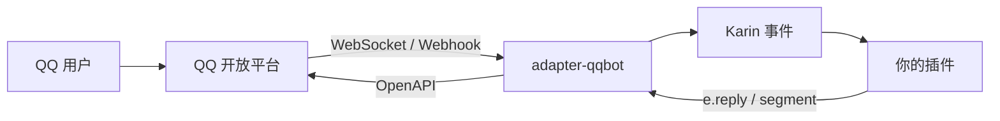

# @karinjs/adapter-qqbot

[](https://www.npmjs.com/package/@karinjs/adapter-qqbot)
[](https://www.npmjs.com/package/@karinjs/adapter-qqbot)
[](https://karinjs.github.io/karin-plugin-adapter-qqbot/)

把 QQ 官方机器人接进 Karin。单聊、群聊、频道、频道私信和按钮回调都走同一套 Karin 插件写法，需要调官方接口时用 `bot.super`。

```bash
pnpm add @karinjs/adapter-qqbot -w
```

重启 Karin，在任意已连接的机器人会话或控制台发送 `#QQBot登录`，用手机 QQ 扫码即可。要求 Node.js >= 22、Karin >= 1.15。

## 能做什么

- **事件接入**：把 `C2C_MESSAGE_CREATE`、`GROUP_AT_MESSAGE_CREATE`、`GROUP_MESSAGE_CREATE`、频道消息、按钮回调转换成 Karin 的 `message`、`notice` 和 `request` 事件。
- **消息发送**：文本、Markdown、按钮、图片、视频、语音、文件和单聊流式消息，按场景自动选择发送通道。
- **媒体处理**：支持 `fileToUrl`、QQ 素材管理（`qqbot-media://`）和内置临时图床，图片可以直接写进 Markdown。
- **官方 API**：`bot.super` 覆盖消息、素材、群管理、频道、菜单、指令面板等模块，未封装的接口可以用裸请求调用。
- **消息缓存**：可选 SQLite 缓存，让 `bot.getMsg`、撤回和引用解析在进程重启后仍然可用。



## 插件里怎么用

`e.bot` 收窄成 `AdapterQQBot` 之后就能访问官方接口：

```ts
import karin from 'node-karin'
import type { AdapterQQBot } from '@karinjs/adapter-qqbot'

export const me = karin.command(/^#me$/i, async (e) => {
  const bot = e.bot as AdapterQQBot
  const info = await bot.super.meta.getMe()
  await e.reply(`我是 ${info.username}`)
})
```

Karin 的插件 API（`karin.command`、`segment`、`karin.accept`、`fileToUrl`）以 [Karin 官方文档](https://karinjs.com) 为准。QQBot 特有的部分写在[适配器文档](https://karinjs.github.io/karin-plugin-adapter-qqbot/)里：

| 文档                                                                                       | 内容                               |
| ------------------------------------------------------------------------------------------ | ---------------------------------- |
| [部署指南](https://karinjs.github.io/karin-plugin-adapter-qqbot/docs/deploy/)              | 安装、扫码登录、配置项和排障       |
| [事件映射](https://karinjs.github.io/karin-plugin-adapter-qqbot/docs/develop/events/)      | 官方事件到 Karin 事件的对应关系    |
| [消息能力](https://karinjs.github.io/karin-plugin-adapter-qqbot/docs/develop/messages/)    | 各场景能发什么，按钮和被动回复限制 |
| [图片与文件](https://karinjs.github.io/karin-plugin-adapter-qqbot/docs/develop/media/)     | 媒体处理顺序与 `fileToUrl` 约定    |
| [官方 API](https://karinjs.github.io/karin-plugin-adapter-qqbot/docs/develop/super-api/)   | `bot.super` 的模块划分和裸请求     |
| [能力边界](https://karinjs.github.io/karin-plugin-adapter-qqbot/docs/develop/limitations/) | 哪些 Karin 标准方法不可用或会降级  |

## 配置

配置位于 `@karinjs-adapter-qqbot/config/config.json`，一个数组元素对应一个机器人：

```json
[
  {
    "appId": "1234567890",
    "secret": "your-secret",
    "qqEnable": true,
    "guildEnable": true,
    "guildMode": 0,
    "event": { "type": 2 }
  }
]
```

`event.type` 支持 `0`（关闭事件）、`1`（Webhook）和 `2`（WebSocket，默认）。完整字段见[配置项](https://karinjs.github.io/karin-plugin-adapter-qqbot/docs/deploy/config/)。

## 仓库结构

这个仓库是 pnpm 工作区，只有 `@karinjs/adapter-qqbot` 会发布到 npm：

| 目录                | 包名                              | 说明                                     |
| ------------------- | --------------------------------- | ---------------------------------------- |
| `packages/adapter`  | `@karinjs/adapter-qqbot`          | 适配器本体                               |
| `packages/docs`     | `@karinjs/adapter-qqbot-docs`     | Fumadocs 文档站，静态部署到 GitHub Pages |
| `packages/api-docs` | `@karinjs/adapter-qqbot-api-docs` | 官方接口文档抓取、转换与同步             |

## 开发

```bash
pnpm install
pnpm build        # 构建适配器
pnpm test         # 适配器测试
pnpm typecheck    # 所有子包类型检查
pnpm lint         # oxlint
pnpm format       # oxfmt
pnpm docs:dev     # 文档站 http://localhost:3000
pnpm docs:build   # 文档静态导出到 packages/docs/out
pnpm docs:start   # serve out
```

适配器使用 TypeScript 7 和 Oxc 工具链（oxlint + oxfmt）。文档站的代码块通过 Twoslash 直接引用 `packages/adapter/src` 的类型，不需要先构建适配器。

文档站由 `.github/workflows/docs.yml` 构建并部署到 GitHub Pages。首次使用时，把仓库 Settings → Pages 的 Source 设为 GitHub Actions。

## License

MIT
